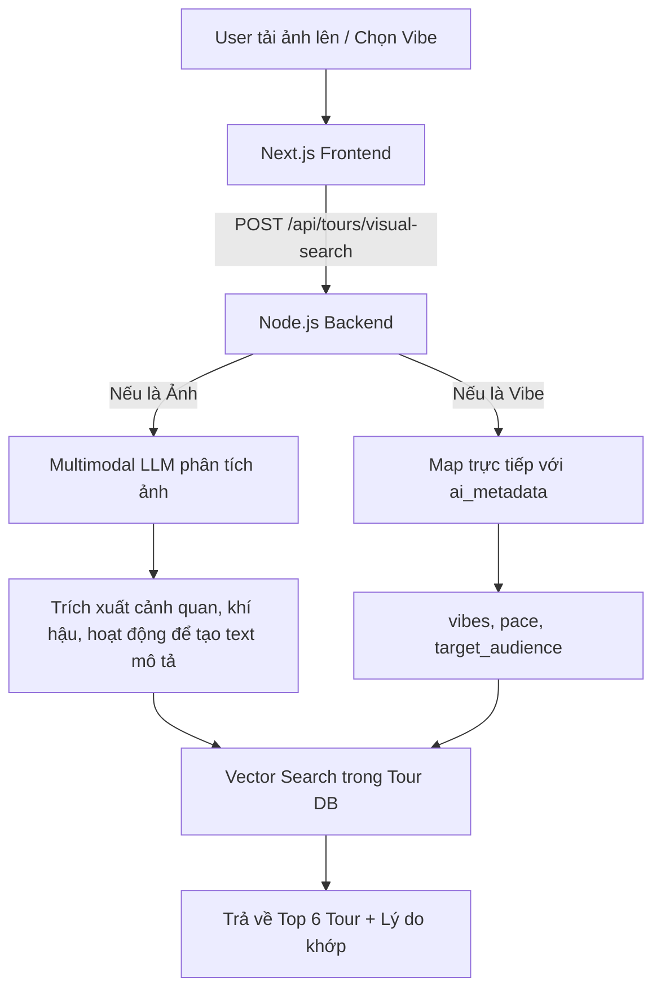

# Thiết kế AI gợi ý tour du lịch

> Ký hiệu `[…]` đánh dấu phần chữ bị cắt ở mép trang PDF.
## Response

Việc tích hợp AI gợi ý tour (AI Travel Recommendation) không chỉ giúp cá nhân hóa trải nghiệm người dùng mà còn là đòn bẩy tăng tỷ lệ chuyển đổi (conversion rate) mạnh mẽ cho website du lịch.

Dưới đây là bản phác thảo ý tưởng toàn diện từ góc độ trải nghiệm người dùng (UX), tính năng cốt lõi, dữ liệu đến lộ trình triển khai để bạn có thể áp dụng ngay:

### 1. Định hình các "Điểm chạm" của AI trên Website (UX Flow)

Thay vì chỉ nhét AI vào một góc chat, hãy rải các tính năng gợi ý thông minh xuyên suốt hành trình của khách hàng:

- Trợ lý Hội thoại Trực quan (AI Trip Planner / Chatbot thế hệ mới):
  - Người dùng nhập yêu cầu bằng ngôn ngữ tự nhiên: "Tìm tour 4 ngày 3 đêm đi Đà Lạt cho gia đình có trẻ nhỏ và người lớn tuổi, ngân sách dưới 5 triệu/người, thích nghỉ dưỡng nhẹ nhàng."
  - AI trả về 2–3 lịch trình tour khớp nhất, kèm lý do tại sao tour đó phù hợp (VD: "Tour này chọn khách sạn ở trung tâm, ít di chuyển dốc, phù hợp với người lớn tuổi").
- Tìm kiếm bằng Cảm hứng & Hình ảnh (Vibe & Visual Search):
  - Cho phép khách tải lên một bức ảnh phong cảnh (từ TikTok, Instagram) hoặc chọn theo cảm xúc ("Chữa lành", "Săn mây", "Khám phá ẩm thực địa phương"). AI sẽ phân tích và gợi ý các tour có điểm đến/hoạt động tương tự.
- Gợi ý Thông minh "Đúng thời điểm" (Dynamic Contextual Recommendation):
  - Tự động thay đổi danh sách tour đề xuất ngoài trang chủ dựa trên: Thời tiết/Mùa vụ (mùa hoa dã quỳ, mùa nước nổi), Vị trí địa lý (gợi ý tour khởi hành từ TP.HCM hoặc Hà Nội), và Lịch sử xem của khách.
- Tùy biến Tour Linh hoạt (AI Tour Customizer):
  - Khi khách đang xem một tour có sẵn nhưng chưa ưng ý hoàn toàn, AI cho phép họ bấm "Tùy chỉnh tour này với AI" (VD: đổi khách sạn 3 sao lên 4 sao, bỏ điểm tham quan A thay bằng quán cà phê B) và tự động tính lại giá dự kiến.

### 2. Các Tính năng Độc đáo Tạo lợi thế Cạnh tranh (USP)

Để khác biệt với các website OTA thông thường, AI của bạn nên có những điểm nhấn sau:

- Giải thích Lý do Gợi ý (Explainable AI): Đừng chỉ hiện danh sách tour. Hãy thêm một dòng tag nhỏ do AI tự sinh dưới mỗi tour: "Phù hợp 95% với bạn vì: Có lịch trình thư giãn + Đúng dịp lễ 30/4 + Khởi hành từ TP.HCM".
- So sánh Tour Tự động (AI Tour Comparator): Khi khách phân vân giữa 2–3 tour, AI tự động tóm tắt bảng so sánh ưu/nhược điểm (về giá, mật độ di chuyển, chất lượng lưu trú, điểm nhấn trải nghiệm) để khách dễ chốt đơn.
- Dự đoán Ngân sách & Thời điểm Vàng: AI cảnh báo hoặc gợi ý: "Nếu bạn dời ngày đi sang tuần sau, giá tour này giảm 15% và thời tiết ít mưa hơn."
- Gợi ý Nhóm (Group Consensus AI): Tạo một link chia sẻ cho nhóm bạn/gia đình; mỗi người nhập sở thích riêng, AI sẽ tổng hợp và tìm ra tour "trung hòa" được mong muốn của tất cả mọi người.

### 3. Logic Dữ liệu & Thuật toán Gợi ý (Data & Engine)

Để AI gợi ý chính xác, hệ thống cần kết hợp 3 lớp dữ liệu:

| Lớp dữ liệu | Thông tin thu thập | Cách AI sử dụng |
| --- | --- | --- |
| 1. Dữ liệu Sản phẩm (Tour Metadata) | Điểm đến, số ngày, giá, đối tượng phù hợp (cặp đôi, gia đình, phượt), nhịp độ tour (nhanh/chậm), tiện ích đi kèm. | Gắn thẻ (auto-tagging) bằng LLM để AI hiểu sâu bản chất từng tour thay vì chỉ lọc theo từ khóa cứng. |
| 2. Hành vi Người dùng (User Behavior) | Các tour đã click, thời gian dừng lại ở từng phần (lịch trình, bảng giá, review), từ khóa tìm kiếm, lịch sử đặt tour. | Dùng thuật toán Collaborative Filtering (Lọc cộng tác) để gợi ý: "Những người có gu giống bạn cũng đặt tour này". |
| 3. Ngữ cảnh Thực tế (Context) | Thời gian hiện tại, mùa lễ hội, dự báo thời tiết tại điểm đến, tình trạng chỗ trống của tour. | Ưu tiên đẩy các tour sắp khởi hành còn chỗ hoặc đang vào mùa đẹp nhất. |

### 4. Lộ trình Triển khai Đề xuất (3 Giai đoạn)

Để tối ưu chi phí và kiểm chứng hiệu quả sớm, bạn nên triển khai theo hướng cuốn chiếu (MVP trước, mở rộng sau):

1. Giai đoạn 1: MVP – Trợ lý Tìm kiếm & Tư vấn (1 – 1.5 tháng)
   - Tích hợp khung chat AI (dùng API của OpenAI/Gemini kết hợp kỹ thuật RAG – truy xuất dữ liệu từ database tour của chính website bạn để tránh AI "bịa" tour không có thật).
   - Triển khai tính năng gắn thẻ (Auto-tagging) toàn bộ danh sách tour hiện có.
2. Giai đoạn 2: Cá nhân hóa Giao diện & So sánh (1 – 2 tháng)
   - Cá nhân hóa mục "Tour dành riêng cho bạn" dựa trên hành vi lướt web của khách (kể cả khách chưa đăng nhập thông qua cookie/session).
   - Ra mắt tính năng So sánh nhanh giữa các tour bằng AI.
3. Giai đoạn 3: Tùy biến Sâu & Tự động hóa Marketing (Mở rộng)
   - Cho phép khách tự thiết kế lại lịch trình tour có sẵn và gửi yêu cầu báo giá tự động cho đội ngũ sale/điều hành tour.
   - Tích hợp AI gửi email/thông báo đẩy (push notification) gợi ý tour cá nhân hóa dựa trên lịch sử tìm kiếm cũ.

### 5. Lưu ý Kỹ thuật Quan trọng

- Chống "Ảo giác" (Hallucination): AI tuyệt đối không được tự bịa ra giá tour hoặc lịch trình không có trong hệ thống. Cần dùng kiến trúc RAG (Retrieval-Augmented Generation) kết hợp Function Calling để AI chỉ lấy dữ liệu thật từ kho tour của bạn.
- Chuyển tiếp mượt mà sang Nhân viên Tư vấn (Human-in-the-loop): Với các đoàn lớn (MICE, company trip) hoặc khách yêu cầu quá phức tạp, AI cần nhận diện được và đẩy toàn bộ lịch sử trò chuyện sang nhân viên sale kèm bản tóm tắt nhu cầu để chốt khách nhanh nhất.

---

## User prompt

khung chat AI thì t có rồi, còn lại thì chưa, trình bày cách thiết kế các mục còn lại chi tiết cho t tham khảo

## Response

Vì bạn đã có sẵn khung chat AI (với nền tảng Next.js / React + Node.js API như trên JourniTrip), phần giá trị nhất tiếp theo là biến AI thành trải nghiệm trực quan ngay trên UI/UX của các trang (Trang chủ, Danh sách tour, Chi tiết tour) để khách không cần phải mở chat vẫn nhận được gợi ý thông minh.

Dưới đây là bản thiết kế chi tiết về UI/UX, Luồng dữ liệu và Kiến trúc kỹ thuật cho 4 hạng mục còn lại để bạn triển khai trực tiếp vào codebase của mình:

### 1. Hệ thống Auto-Tagging & Vector Database (Nền tảng dữ liệu lõi)

Trước khi làm giao diện, bạn cần nâng cấp dữ liệu tour trong database (thêm một bảng hoặc trường ai_metadata) để AI hiểu "chất" của từng tour thay vì chỉ đọc text thô.

- Cách hoạt động (Chạy ngầm ở Backend Node.js khi Admin tạo/sửa tour):
  - Gửi toàn bộ mô tả, lịch trình, giá, điểm khởi hành của tour qua LLM (với Structured Outputs / JSON schema) để tự động trích xuất các thuộc tính chuẩn hóa:
    - `vibes`: ["chữa lành", "nghỉ dưỡng", "săn mây", "khám phá văn hóa"]
    - `target_audience`: ["gia đình có trẻ nhỏ", "người lớn tuổi", "cặp đôi", "nhóm bạn"]
    - `pace`: "nhẹ nhàng" | "trung bình" | "di chuyển nhiều"
    - `best_seasons`: [11, 12, 1, 2] (tháng đẹp nhất)
    - `ai_summary_pitch`: Câu giới thiệu 1 dòng đắt giá nhất của tour.
  - Đồng thời, tạo Vector Embedding từ nội dung tour và lưu vào DB (dùng pgvector nếu dùng PostgreSQL, hoặc MongoDB Atlas Vector Search / Qdrant) để phục vụ tìm kiếm theo ngữ nghĩa và hình ảnh.

### 2. Tìm kiếm bằng Cảm hứng & Hình ảnh (Vibe & Visual Search)

Thay vì thanh Search truyền thống khô khan (Điểm đến | Ngày đi | Số khách), hãy nâng cấp Hero Search Bar trên trang chủ thành dạng Hybrid Search.

#### Thiết kế UI/UX

- Thanh tìm kiếm mở rộng: Thêm 2 nút chức năng ngay cạnh ô nhập liệu:
  1. Nút "Tìm theo Vibe / Tâm trạng" (Mood Chips): Khi bấm vào, xổ ra các thẻ tag trực quan có icon (VD: ☁️ Săn mây & Chữa lành, 🏖️ Biển xanh nghỉ dưỡng, 🍜 Food tour bản địa, 👨‍👩‍👧‍👦 Nhẹ nhàng cho gia đình).
  2. Nút "Tìm bằng Ảnh" (Camera Icon): Cho phép kéo-thả hoặc dán link một bức ảnh phong cảnh khách thích từ TikTok/Instagram.
- Trang kết quả: Hiển thị danh sách các Tour Card có độ tương đồng cao nhất, kèm thanh điểm khớp (VD: Khớp 92% với ảnh của bạn).

#### Luồng kỹ thuật (Flow)



### 3. Gợi ý Động theo Ngữ cảnh & Explainable AI (Trên Tour Card)

Biến các block tĩnh trên Trang chủ thành block động cá nhân hóa cho từng khách, kể cả khi họ chưa đăng nhập.

#### Thiết kế UI/UX

- Section "Dành riêng cho hành trình của bạn" (Trang chủ):
  - Nằm ngay dưới Hero Banner. Nếu là khách mới tinh, hiển thị theo Ngữ cảnh thực tế (tháng hiện tại, thời tiết, địa điểm khởi hành từ IP/trình duyệt). Nếu khách đã xem vài tour, tự động đổi thành gợi ý theo gu của họ.
- Nâng cấp Tour Card (Explainable AI Badge):
  - Trên mỗi Tour Card, thêm một dải badge nhỏ tinh tế (dùng icon tia sáng ✨) giải thích ngắn gọn tại sao tour này hợp với khách:
    - Ví dụ 1 (Theo hành vi): ✨ Hợp với bạn: Lịch trình ít dốc, phù hợp gia đình bạn vừa xem
    - Ví dụ 2 (Theo mùa vụ): ✨ Thời điểm vàng: Đang vào mùa hoa dã quỳ đẹp nhất năm
    - Ví dụ 3 (Theo ngân sách/hạng thành viên): ✨ Tối ưu cho hạng Vàng: Giảm thêm 5% + Tặng vé cáp treo

#### Luồng kỹ thuật (Tracking nhẹ & Realtime Ranking)

1. Frontend Tracking (Không cần login): Lưu một mảng nhỏ tối đa 10 hành động gần nhất vào localStorage hoặc Cookie (viewed_tour_ids, filtered_vibes, price_range).
2. Backend Scoring API (POST /api/tours/recommended):
   - Nhận user_context (lịch sử xem từ localStorage + userId nếu đã đăng nhập + tháng hiện tại).
   - Tính điểm Match Score cho các tour đang mở bán dựa trên trọng số: 40% Vector Similarity (gu người dùng) + 30% Ngữ cảnh mùa vụ/vị trí + 30% Tỷ lệ chuyển đổi/Còn chỗ.
   - Dùng một prompt LLM siêu nhẹ (hoặc template thông minh kết hợp ai_summary_pitch) để sinh câu lý do 10–15 từ cho Top 4 tour hiển thị đầu tiên (cache theo session để không tốn token).

### 4. So sánh Tour Thông minh (AI Tour Comparator)

Giải quyết nỗi đau lớn nhất của khách đặt tour: mở 4–5 tab tour khác nhau mà không biết tour nào đáng tiền hơn.

#### Thiết kế UI/UX

- Nút kích hoạt: Trên mỗi Tour Card, thêm nút nhỏ + So sánh. Khi khách chọn từ 2 đến 3 tour, hiện một Floating Bar ở đáy màn hình hiển thị thumbnail các tour đã chọn + nút "✨ Nhờ AI phân tích & so sánh".
- Giao diện Bảng So Sánh (Modal hoặc Drawer trượt ngang):
  - Phần 1 – Tóm tắt chốt hạ của AI (AI Verdict): 1 box nổi bật ở trên cùng đưa ra lời khuyên theo từng đối tượng.
    - VD: "Chọn Tour A nếu bạn ưu tiên khách sạn 4 sao gần biển và lịch trình thư thả. Chọn Tour B nếu muốn đi trọn vẹn các điểm check-in hot nhất với chi phí tiết kiệm hơn 1.2 triệu."
  - Phần 2 – Bảng đối chiếu trực quan: So sánh theo các tiêu chí thực tế mà AI tự rút trích từ lịch trình:
    - Mức độ di chuyển (Nhẹ nhàng vs Dày đặc)
    - Chất lượng lưu trú & Ăn uống (Bao nhiêu bữa chính, tiêu chuẩn sao)
    - Điểm nhấn độc quyền (Có vé cáp treo/du thuyền không?)
    - Chi phí ẩn (Những gì chưa bao gồm trong giá tour)

#### Luồng kỹ thuật

- Khi bấm nút So sánh, Frontend gửi mảng tour_ids lên POST /api/tours/compare.
- Backend lấy full JSON lịch trình của 2–3 tour đó, gửi qua LLM với JSON Schema cố định để trả về verdict và comparison_matrix.
- Mẹo tối ưu tốc độ & chi phí: Hash cặp tour_ids (đã sort, VD: compare_TOUR001_TOUR004) và lưu cache vào Redis/DB trong 24h. Người dùng sau bấm so sánh đúng cặp tour này sẽ ra kết quả tức thì (0ms) mà không tốn thêm lượt gọi API AI.

### 5. Tùy biến Tour Linh hoạt (AI Tour Customizer)

Đặt ngay trong Trang Chi tiết Tour, biến một tour cố định thành tour thiết kế riêng (Tailor-made tour) để tăng tỷ lệ chốt đơn cho khách nhóm/gia đình.

#### Thiết kế UI/UX

- Điểm chạm: Ngay cạnh nút "Đặt tour ngay", đặt một nút phụ nổi bật: "✨ Tùy chỉnh lịch trình tour này".
- Giao diện Slide-over Drawer (Ngăn kéo trượt từ bên phải):
  - Hiển thị lịch trình gốc theo từng ngày (Ngày 1, Ngày 2, Ngày 3) ở dạng các thẻ có thể chỉnh sửa.
  - Cung cấp các Quick Action Chips (Nút bấm nhanh) + ô nhập yêu cầu tự do:
    - 🏨 Nâng hạng khách sạn lên 4–5 sao
    - 🚗 Đổi sang xe riêng cho nhóm gia đình
    - 🌿 Giảm bớt điểm tham quan, tăng thời gian nghỉ ngơi
    - 🍽️ Thêm trải nghiệm ẩm thực địa phương buổi tối
  - Kết quả hiển thị trực tiếp: AI cập nhật lại từng ngày trong lịch trình (đánh dấu màu xanh những đoạn mới sửa), kèm Bảng ước tính chênh lệch ngân sách (VD: Dự kiến tăng thêm: +850.000đ / khách).
  - Nút hành động cuối: "Gửi yêu cầu giữ chỗ & Nhận báo giá chính xác" -> Đẩy toàn bộ lịch trình AI vừa chế biến thẳng vào hệ thống Admin/Sale để nhân viên gọi điện chốt đơn.

#### Luồng kỹ thuật

- Sử dụng cơ chế Function Calling / Tool Use của LLM:
  - Cung cấp cho AI danh sách các Add-on / Dịch vụ bổ sung có thật trong database của bạn (bảng giá nâng hạng phòng, giá thuê xe riêng theo số chỗ, giá vé các điểm tham quan phụ).
  - Khi khách yêu cầu đổi, AI sẽ đối chiếu với bảng giá add-on này để tính ra mức giá ước tính sát thực tế nhất, tránh việc AI tự bịa giá gây khó xử cho đội ngũ Sale khi báo giá lại.

### Thứ tự ưu tiên triển khai gợi ý

Nếu làm lần lượt để thấy hiệu quả sớm nhất trên website, bạn nên đi theo thứ tự:

1. Bước 1: Làm Auto-tagging cho DB tour (mất khoảng 1–2 ngày code script chạy batch cho toàn bộ tour cũ + hook vào API tạo tour mới).
2. Bước 2: Làm AI Tour Comparator (So sánh 2–3 tour) — Tính năng này cực kỳ dễ làm UI, dễ cache kết quả, nhưng khách hàng rất thích bấm vì đánh trúng tâm lý đắn đo trước khi thanh toán.
3. Bước 3: Làm Vibe Search & Explainable Badge trên Trang chủ/Trang danh sách tour.
4. Bước 4: Làm AI Tour Customizer ở Trang chi tiết tour để thu lead chất lượng cao cho đội điều hành tour.

---

## User prompt

z là phải tạo 1 bảng mới dùng để gắn metadata vào, chỗ này t hiểu sơ sơ, tiếp là phần lấy hành vi người dùng, chỗ này t chưa rõ, tiếp là so sánh tour,

## Response

Để dễ hình dung và áp dụng ngay vào kiến trúc Next.js + Node.js API của JourniTrip, mình sẽ bóc tách thật thực tế 2 phần bạn đang quan tâm: Lấy hành vi người dùng (không làm chậm web, không bắt buộc login) và So sánh tour bằng AI (cấu trúc dữ liệu & luồng xử lý).

### 1. Cách lấy Hành vi Người dùng (User Behavior Tracking)

Với một website du lịch, phần lớn khách sẽ lướt xem trước khi đăng nhập. Vì vậy, thiết kế chuẩn nhất là kết hợp Client Storage (cho khách vãng lai) và Database Event (cho khách đã login / phân tích sâu).

#### Bước 1: Thu thập những tín hiệu nào? (Chỉ lấy cái đắt giá)

Đừng track mọi cú rê chuột vì sẽ làm rác database. Chỉ cần gom 4 hành động sau thành một object gọn nhẹ:

1. viewed_tours: ID của 5–10 tour khách vừa bấm vào xem chi tiết (kèm thời gian ở lại trang > 15 giây để loại bỏ click nhầm).
2. searched_keywords: Các từ khóa họ từng gõ vào ô tìm kiếm (VD: "Đà Lạt", "biển", "3 ngày 2 đêm").
3. applied_filters: Các bộ lọc họ hay bấm (VD: khoảng giá 5tr - 8tr, khởi hành từ TP.HCM).
4. wishlist_tours: Các tour họ bấm nút thả tim / lưu lại.

#### Bước 2: Lưu trữ & Đồng bộ (Hybrid Tracking)

- Ở Frontend (Next.js):
  - Tạo một custom hook (ví dụ useUserBehavior()) hoặc lưu trong localStorage dưới key journitrip_user_signals.
  - Mỗi lần khách vào trang /tours/[id], dùng setTimeout 15 giây; nếu khách vẫn đang ở trang đó thì push tourId vào đầu mảng viewed_tours (giữ tối đa 10 phần tử gần nhất).
- Gửi về Backend Node.js khi cần gợi ý:
  - Khi khách quay lại Trang chủ, Next.js gọi API POST /api/tours/recommendations và đính kèm luôn cục JSON journitrip_user_signals trong body (cùng userId nếu khách đã đăng nhập).
  - Mẹo: Nếu khách đăng nhập, Backend sẽ merge viewed_tours từ localStorage vào bảng UserBehavior trong DB để đồng bộ giữa điện thoại và máy tính.

#### Bước 3: Backend biến hành vi thành Gợi ý như thế nào?

Giả sử khách vừa xem 3 tour: Sa Pa - Fansipan 3N2Đ, Hà Giang 4N3Đ, và Mộc Châu 2N1Đ.

1. Backend lấy ai_metadata của 3 tour này (từ bảng metadata bạn tạo ở bước trước) và thấy điểm chung là: vibes: ["săn mây", "núi rừng"], pace: "khám phá", ngân sách trung bình ~4 - 6 triệu.
2. Backend truy vấn các tour khác có cùng vibes và tầm giá (loại trừ 3 tour đã xem) -> Ra được Tà Xùa 2N1Đ hoặc Cao Bằng - Thác Bản Giốc 3N2Đ.
3. Trả về Frontend kèm câu lý do tự động ghép từ metadata: "✨ Gợi ý vì bạn vừa quan tâm các hành trình săn mây & khám phá vùng cao".

### 2. Thiết kế chi tiết tính năng So sánh Tour (AI Tour Comparator)

Tính năng này giúp khách đang phân vân giữa 2–3 tour (ví dụ đang đắn đo giữa Nha Trang biển đảo 3N2Đ và Phú Quốc 3N2Đ) ra quyết định ngay lập tức.

#### A. Thiết kế UI/UX (Trải nghiệm trên màn hình)

1. Trên mỗi Tour Card: Thêm một checkbox/nút nhỏ ở góc thẻ: [ + So sánh ]. Khi bấm vào sẽ đổi trạng thái thành [ ✓ Đang chọn ].
2. Thanh công cụ nổi (Floating Comparison Bar):
   - Khi mảng selectedCompareTours có từ 1 phần tử trở lên, hiện một thanh ngang cố định ở đáy màn hình (fixed bottom-4).
   - Hiển thị tối đa 3 ô chứa ảnh thumbnail + tên rút gọn của các tour đã chọn (cùng nút x để bỏ chọn).
   - Nút CTA chính: "✨ So sánh bằng AI (2/3)" (chỉ enable khi chọn đủ 2 hoặc 3 tour).
3. Drawer / Modal Kết quả So sánh:
   - Chia làm 3 tầng thông tin rõ ràng từ trên xuống dưới:
     - Tầng 1 – Chốt hạ của AI (AI Quick Verdict): Một khung nổi bật tóm tắt: Ai nên chọn tour nào?
     - Tầng 2 – Bảng so sánh theo tiêu chí thực tế: Các cột là từng Tour (kèm giá, nút "Đặt ngay" ở đầu cột); các hàng là tiêu chí do AI bóc tách từ lịch trình.
     - Tầng 3 – Điểm khác biệt lớn nhất: 2–3 gạch đầu dòng chỉ ra sự đánh đổi (VD: Tour A đắt hơn 1.2tr nhưng bay thẳng và ở resort 4 sao sát biển; Tour B tiết kiệm hơn nhưng di chuyển bằng xe giường nằm).

#### B. Thiết kế API & Cấu trúc JSON trả về từ AI

Khi khách bấm nút So sánh, Frontend gọi: `POST /api/ai/compare-tours` với payload: `{ "tourIds": ["TOUR004", "SCH2026008"] }`.

Ở Backend Node.js, bạn lấy thông tin chi tiết + lịch trình của các tour này, sau đó gọi LLM (OpenAI / Gemini) ép trả về đúng định dạng JSON Schema dưới đây để Frontend render thẳng lên bảng mà không lo vỡ layout:

```json
{
  "verdict": {
    "summary": "Cả hai đều là tour 3N2Đ giá tầm trung, nhưng khác biệt hoàn toàn về trải nghiệm khí hậu và nhịp độ di ch […]",
    "best_for": [
      {
        "tourId": "TOUR004",
        "recommendation": "Chọn Nha Trang 3N2Đ nếu bạn muốn nghỉ dưỡng biển đảo, ít đi bộ leo dốc và thích ẩm thực hải s […]"
      },
      {
        "tourId": "SCH2026008",
        "recommendation": "Chọn Sa Pa 3N2Đ nếu bạn thích không khí se lạnh, săn mây trên đỉnh Fansipan và khám phá văn h […]"
      }
    ]
  },
  "criteria_matrix": [
    {
      "criterion": "Nhịp độ di chuyển",
      "values": {
        "TOUR004": "Nhẹ nhàng (chủ yếu đi cano đảo & xe du lịch)",
        "SCH2026008": "Trung bình - Khá (có đi bộ tham quan bản Cát Cát)"
      }
    },
    {
      "criterion": "Lưu trú & Ăn uống",
      "values": {
        "TOUR004": "Khách sạn 4 sao gần biển • 4 bữa chính",
        "SCH2026008": "Khách sạn 3 sao trung tâm • 5 bữa chính (có lẩu cá tầm)"
      }
    },
    {
      "criterion": "Điểm nhấn đắt giá nhất",
      "values": {
        "TOUR004": "Lặn ngắm san hô Hòn Mun & Tiệc bar nổi",
        "SCH2026008": "Chinh phục đỉnh Fansipan & Check-in Moana"
      }
    },
    {
      "criterion": "Chi phí phát sinh cần lưu ý",
      "values": {
        "TOUR004": "Chưa gồm vé VinWonders nếu đi tự túc",
        "SCH2026008": "Chưa gồm vé cáp treo Fansipan (khoảng 800k)"
      }
    }
  ],
  "key_tradeoff": "Nha Trang tối ưu cho thư giãn biển cả, trong khi Sa Pa thiên về trải nghiệm cảnh quan núi non và chec […]"
}
```

#### C. Mẹo kỹ thuật để chạy mượt & tiết kiệm chi phí API

- Tạo Cache Key cố định: Trước khi gọi AI, hãy sắp xếp mảng tourIds theo thứ tự bảng chữ cái rồi nối lại (VD: ["TOUR004", "SCH2026008"] -> key là compare:SCH2026008_TOUR004).
- Lưu vào DB / Redis: Lưu kết quả JSON trên vào một bảng TourComparisonCache (kèm updatedAt). Nếu sau này Admin không sửa nội dung 2 tour đó, bất kỳ khách nào bấm so sánh cặp này đều nhận kết quả sau 50ms và tốn 0 đồng tiền token AI.
- Hiệu ứng Loading tạo cảm giác "AI đang làm việc": Trong 2–3 giây đầu tiên (khi chưa có cache), thay vì xoay vòng tròn nhàm chán, hãy cho chạy dòng chữ trạng thái tuần tự: "Đang đọc lịch trình chi tiết..." -> "Đang đối chiếu tiêu chuẩn khách sạn & chi phí ẩn..." -> "Đang tổng hợp lời khuyên...". Trải nghiệm này làm người dùng cảm thấy kết quả rất đáng tin cậy.

---

## User prompt

viết prompt trình bày lại mấy ý nảy giờ đi, mà có chỗ trên thẻ tour thay vì hiện có ô tích chọn thì nó hiện cái menu ... như hình, bấm vào thì nó có mục chọn [+ so sánh] như m trình bày hồi nảy, r ý t có nhiêu á, m trình bày lại đi

## Response

Dưới đây là bản Specification Prompt chuẩn chỉnh, đóng gói toàn bộ ý tưởng bạn vừa chốt (gồm: bảng ai_metadata, tracking hành vi người dùng nhẹ, gợi ý tour cá nhân hóa có giải thích, và tính năng So sánh tour bằng AI tích hợp vào nút menu ba chấm ... ở góc trên bên phải Tour Card như trong ảnh).

Bạn chỉ cần copy nguyên văn khung bên dưới dán vào Cursor / Claude / Copilot để AI code theo đúng kiến trúc dự án của bạn:

### YÊU CẦU TRIỂN KHAI HỆ THỐNG AI GỢI Ý & SO SÁNH TOUR DU LỊCH (JOURNTRIP)

#### BỐI CẢNH & KIẾN TRÚC HIỆN TẠI

- **Tech Stack:** Next.js (App Router/React), Tailwind CSS, Node.js API Backend.
- **Hiện trạng:** Website đã có sẵn tính năng Chatbot AI và giao diện Tour Card hoàn chỉnh.
- **Mục tiêu:** Xây dựng hệ thống gợi ý tour cá nhân hóa dựa trên hành vi thực tế của người dùng và tính năng So sánh To […]

---

#### PHẦN 1: CƠ SỞ DỮ LIỆU & AUTO-TAGGING (TOUR AI METADATA)

Tạo bảng/collection mới `TourAIMetadata` (liên kết 1-1 với bảng `Tours` qua `tourId`) để lưu trữ các thuộc tính ngữ nghĩ […]

- **Cấu trúc trường dữ liệu:**
  - `tourId`: Khóa ngoại liên kết với tour gốc.
  - `vibes`: Mảng string (VD: `["săn mây", "chữa lành", "nghỉ dưỡng biển", "khám phá văn hóa", "ẩm thực"]`).
  - `targetAudience`: Mảng string (VD: `["gia đình có trẻ nhỏ", "người lớn tuổi", "cặp đôi", "nhóm bạn"]`).
  - `pace`: String (`"nhẹ nhàng"` | `"trung bình"` | `"di chuyển nhiều"`).
  - `bestSeasons`: Mảng số nguyên từ 1 đến 12 đại diện cho các tháng đẹp nhất để đi tour này.
  - `aiSummaryPitch`: String (1 câu tóm tắt điểm đắt giá nhất của tour, tối đa 15 từ).

- **Luồng hoạt động:** Tạo service tự động gọi LLM (sử dụng Structured Outputs / JSON Schema) để phân tích mô tả và lịch […]

---

#### PHẦN 2: THU THẬP HÀNH VI NGƯỜI DÙNG (HYBRID USER BEHAVIOR TRACKING)

Xây dựng cơ chế theo dõi hành vi nhẹ nhàng, hoạt động tốt cho cả **khách vãng lai (chưa đăng nhập)** và **thành viên đã […]**

1. **Dữ liệu thu thập (Client-side Hook `useUserBehavior`):**
   - Lưu trữ tại `localStorage` dưới key `journitrip_user_signals` (giới hạn tối đa 10 mục gần nhất cho mỗi loại để tối […])
     - `viewedTours`: Mảng `{ tourId, viewedAt }` — chỉ ghi nhận khi người dùng ở lại trang chi tiết tour `/tours/[id]` […]
     - `searchedKeywords`: Mảng từ khóa tìm kiếm gần đây.
     - `appliedFilters`: Các bộ lọc hay dùng (khoảng giá, điểm khởi hành, thời lượng tour).
     - `wishlistTours`: Danh sách `tourId` người dùng đã bấm icon trái tim.

2. **Đồng bộ & Xử lý (Backend API `POST /api/tours/recommendations`):**
   - Frontend gửi kèm cục JSON `journitrip_user_signals` (và `userId` nếu đã login) lên Backend.
   - Nếu đã đăng nhập, merge dữ liệu vào DB người dùng để đồng bộ đa thiết bị.
   - **Logic gợi ý:** Trích xuất `vibes`, `pace` và khoảng giá chung từ các tour trong `viewedTours` / `wishlistTours` - […]
   - **Explainable AI Badge:** Trả về kèm mỗi tour gợi ý một trường `aiReason` ngắn gọn (VD: *"✨ Hợp với bạn: Lịch trìn […]"*).

---

#### PHẦN 3: TÍNH NĂNG SO SÁNH TOUR BẰNG AI (AI TOUR COMPARATOR)

##### 1. Thiết kế UI/UX (Tích hợp vào Tour Card hiện tại)

- **Điểm chạm trên Tour Card:**
  - Giữ nguyên bố cục Tour Card hiện tại, tận dụng nút menu ba chấm ngang (`...`) ở góc trên bên phải phần nội dung thẻ […]
  - Khi bấm vào nút `...`, mở một **Dropdown Menu** gọn gàng chứa tùy chọn: **`+ So sánh tour`** (kèm icon cân/so sánh).
  - Nếu tour đã được chọn vào danh sách so sánh, mục này đổi trạng thái thành **`✓ Đang chọn so sánh`** (bấm lần nữa để […])
- **Thanh công cụ nổi (Floating Comparison Bar):**
  - Xuất hiện cố định ở đáy màn hình (`fixed bottom-4`) ngay khi danh sách so sánh có từ **1 tour trở lên** (cho phép ch […])
  - Hiển thị ảnh thumbnail + tên rút gọn của các tour đã chọn (kèm nút `×` xóa nhanh) và nút CTA nổi bật: **`✨ So sánh […]`**
- **Drawer / Modal Kết quả So sánh:**
  - Mở ra khi bấm nút so sánh, gồm 3 phần rõ ràng:
    1. **AI Quick Verdict (Chốt hạ của AI):** Khung tóm tắt tổng quan và gợi ý rõ ràng *nên chọn tour nào cho nhu cầu nà […]*
    2. **Bảng ma trận đối chiếu (Criteria Matrix):** Các cột là từng Tour (kèm giá & nút *"Đặt ngay"*); các hàng là các […]
    3. **Điểm đánh đổi lớn nhất (Key Trade-off):** 1–2 câu chỉ ra sự khác biệt cốt lõi về giá trị giữa các tour.

##### 2. Kiến trúc API & Tối ưu Caching

- **Endpoint:** `POST /api/ai/compare-tours` với body `{ "tourIds": ["ID_1", "ID_2"] }`.
- **Caching thông minh:**
  - Sắp xếp mảng `tourIds` theo thứ tự alphabet để tạo cache key duy nhất (VD: `compare:ID_1_ID_2`).
  - Kiểm tra trong bảng `TourComparisonCache` (hoặc Redis). Nếu đã có dữ liệu và các tour không bị chỉnh sửa kể từ lần c […]
- **Cấu trúc JSON Output bắt buộc từ LLM:**
  ```json
  {
    "verdict": {
      "summary": "Tóm tắt ngắn gọn điểm khác biệt chính giữa các tour",
      "best_for": [
        {
          "tourId": "string",
          "recommendation": "Lời khuyên cụ thể ai nên chọn tour này"
        }
      ]
    },
    "criteria_matrix": [
      {
        "criterion": "Tên tiêu chí (VD: Nhịp độ di chuyển, Lưu trú, Chi phí ẩn...)",
        "values": {
          "TOUR_ID_1": "Nội dung đánh giá tour 1",
          "TOUR_ID_2": "Nội dung đánh giá tour 2"
        }
      }
    ],
    "key_tradeoff": "Câu chốt so sánh sự đánh đổi lớn nhất giữa chi phí và trải nghiệm"
  }
  ```

- Trạng thái Loading: Trong lúc chờ AI xử lý (khi chưa có cache), hiển thị skeleton kèm dòng trạng thái chạy tuần tự ("Đang đọc lịch trình chi tiết..." -> "Đang đối chiếu dịch vụ & chi phí ẩn..." -> "Đang tổng hợp lời khuyên..