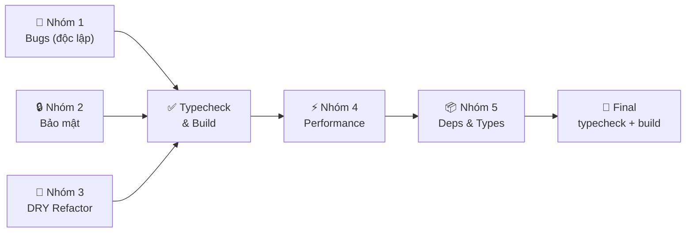

# Kế hoạch Refactor & Tối ưu JourniTrip Monorepo

> [!IMPORTANT]
> Toàn bộ luồng nghiệp vụ đang chạy đúng (VNPay IPN, Workforce locking, Membership cycle, Chat socket) **không được thay đổi hành vi**. Mọi thay đổi phải pass `typecheck` và `build` thành công.

---

## Nhóm 1 — Sửa Bugs Logic Nghiêm Trọng
*6 công việc, tất cả độc lập nhau*

### 1.1 · Dashboard: 3 lỗi thống kê sai số liệu
**File:** `apps/api/src/modules/dashboard/dashboard.service.ts`

| # | Vấn đề hiện tại | Trạng thái | Fix |
|---|---|---|---|
| a | `vnpayPaymentsAgg` lọc `status: 'success'` nhưng `payment.service.ts` lưu giao dịch thành công là `'completed'` → thống kê luôn trả về **0** | ❌ Bug | Đổi thành `method: 'vnpay', status: 'completed'` |
| b | `tierLabels` không có hạng `platinum` → user bạch kim bị hiển thị sai nhãn | ❌ Bug | Thêm `platinum: 'Bạch Kim'` |
| c | `marketing.vouchers.totalDiscountAmount` đang gán cứng `0` | ❌ Bug | `aggregate({ _sum: { discount_amount: true } })` trên bookings có `voucher_id != null` và status trong nhóm thành công |

---

### 1.2 · Đồng bộ hằng số timeout đơn pending
**Vấn đề:** 3 nơi khác nhau đang dùng 3 giá trị khác nhau cho cùng 1 nghiệp vụ:
- `schedules-admin.service.ts`: `HOLDING_HOURS = 12` → **12 tiếng** ❌
- `payment.service.ts` + `booking-status.ts`: **15 phút** ✅

**Kế hoạch:**
1. Thêm hằng số `BOOKING_PENDING_EXPIRY_MS = 15 * 60 * 1000` vào `packages/shared/src/booking/constants.ts` (file mới) và export từ `index.ts`
2. `schedules-admin.service.ts`: thay `HOLDING_HOURS = 12` bằng import hằng số từ shared → tính `expiresTime` đúng
3. `booking-status.ts`: thay literal `15 * 60 * 1000` bằng import từ shared

---

### 1.3 · Tour link bị sai format (`/tours/123-slug` → `/tours/123`)
**Files:** `flash-deals.service.ts:167`, `featured-tours.service.ts:228`

```ts
// Hiện tại (sai):
link: `/tours/${tour.tour_id}-${slug}`

// Đúng (khớp với ParseIntPipe + route [id]):
link: `/tours/${tour.tour_id}`
```

---

### 1.4 · Bộ lọc `tour_type` bị thiếu alias `international`
**File:** `tours-public.service.ts:127`

```ts
// Hiện tại: gán 1:1 → nếu FE gửi 'international' mà DB lưu 'outbound', kết quả rỗng
where.tour_type = params.tour_type;

// Fix: alias hai từ về cùng một set
if (params.tour_type === 'outbound' || params.tour_type === 'international') {
  where.tour_type = { in: ['outbound', 'international'] };
} else {
  where.tour_type = params.tour_type; // 'domestic'
}
```

---

### 1.5 · Phân quyền review reply + race condition like
**File:** `reviews.controller.ts`, `reviews.service.ts`

| # | Vấn đề | Fix |
|---|---|---|
| a | Endpoint `POST reviews/:reviewId/reply`: bất kỳ user đăng nhập nào cũng có thể phản hồi (nhưng UI hiển thị "JourniTrip CSKH") | Kiểm tra `req.user.isStaff === true` trong service, ném `ForbiddenException` nếu không phải nhân viên |
| b | `createReview`: chưa kiểm tra user có booking thuộc tour này không | Query `prisma.bookings.findFirst({ where: { user_id, tour_schedules: { tour_id }, status: { in: ['completed', 'paid'] } } })`, ném `ForbiddenException` nếu null |
| c | `toggleLikeReview`: thêm/xóa like + cập nhật `likes_count` không atomic → race condition | Bọc vào `prisma.$transaction` |

---

### 1.6 · Validation flash deal
**File:** `flash-deals.service.ts`

Thêm guards trước khi create/update:
```ts
if (!['percentage', 'fixed_amount', 'fixed'].includes(dto.discount_type))
  throw new BadRequestException('discount_type không hợp lệ');
if (dto.discount_value <= 0)
  throw new BadRequestException('discount_value phải > 0');
if (dto.discount_type === 'percentage' && dto.discount_value > 100)
  throw new BadRequestException('Phần trăm giảm không được vượt quá 100%');
if (dto.discount_type !== 'percentage' && dto.discount_value >= schedule.price)
  throw new BadRequestException('Giảm giá không được >= giá gốc');
```

---

## Nhóm 2 — Bảo mật & Upload

### 2.1 · Chuẩn hóa Multer cho 3 controller còn thiếu
**Files:** `SchedulesAdminController`, `LocationsAdminController`, `ReviewsController`

Thêm cùng config với `PostsAdminController` đang làm đúng:
```ts
// Thêm vào @UseInterceptors(FileInterceptor('file', { ... }))
limits: { fileSize: 5 * 1024 * 1024, files: 1 },
fileFilter: (_req, file, cb) => {
  if (['image/jpeg', 'image/png', 'image/webp'].includes(file.mimetype)) cb(null, true);
  else cb(new BadRequestException('Chỉ chấp nhận JPEG, PNG, WebP'), false);
}
```

---

### 2.2 · Kiểm tra Socket.IO rewrite trong `next.config.ts`
Xác nhận rewrite `/api/socket.io/:path*` → `${apiOrigin}/socket.io/:path*` giữ nguyên `query` string (quan trọng cho WebSocket upgrade handshake).

---

## Nhóm 3 — Khử trùng lặp Code (DRY)

### 3.1 · Hàm helper tính giá khuyến mãi dùng chung
**Hiện trạng:** Logic `salePrice = price * (1 - discount/100)` hoặc `price - discountValue` đang viết lặp trong:
- `public-tour.mapper.ts`
- `tours-public.service.ts`
- `flash-deals.service.ts`

**Kế hoạch:** Tạo `packages/shared/src/tours/pricing.ts`:
```ts
export function applyDiscount(basePrice: number, type: 'percentage'|'fixed_amount'|'fixed', value: number): number
```
Export từ shared index, dùng ở cả backend và frontend.

---

### 3.2 · Gom query Best Seller vào một nơi
**Hiện trạng:** `tours-public.service.ts::getBestSellerOrder()` và `featured-tours.service.ts::getBestSellerStats()` viết cùng một SQL `SELECT ts.tour_id, COUNT(b.booking_id)...` nhưng riêng lẻ.

**Kế hoạch:** Tạo `apps/api/src/modules/tours/best-seller.helper.ts`:
```ts
export async function queryBestSellerStats(prisma: PrismaService, options?): Promise<BestSellerStat[]>
```
Import vào cả hai service.

---

### 3.3 · Chuẩn hóa HTTP layer ở Frontend
**Hiện trạng:**
- `lib/account/reviewsApi.ts` tự định nghĩa `authFetch()` riêng thay vì dùng `lib/http/authFetch.ts` hoặc `lib/http/publicFetch.ts`

**Kế hoạch:**
- Xóa hàm `authFetch` cục bộ trong `reviewsApi.ts`, thay bằng `import { authFetch } from '@/lib/http/authFetch'` (hoặc tên tương đương đang có)
- Gom 4 hàm upload ảnh rải rác về dùng chung `uploadAuthenticatedFile` từ `lib/http/uploadApi.ts`

---

### 3.4 · Dọn Utils trùng lặp
- **`cleanVND` trong `HomeVoucherDetailModal.tsx`**: Đã sửa xong ở session trước (giữ lại cục bộ). Kiểm tra nếu trùng với `formatVND` từ `@/lib/utils/currency` thì xóa hàm wrapper.
- **Validation functions** (`validateText`, `validateId`, `validateObject`) đang copy-paste giữa `workforce.service.ts`, `schedule-template.ts`, `article-input.ts`: Tạo `apps/api/src/common/validation/payload.ts` tập trung.
- **Model `TourReview` trong `packages/shared/src/tours/models.ts`**: Đang có cả `user?` và `users?`, `replies?` và `review_replies?` → Chọn 1 canonical name, giữ alias bằng `type OldName = NewName` cho backwards compat.

---

## Nhóm 4 — Tối ưu Hiệu năng

### 4.1 · Dashboard `getStats` — topTours N+1 query
**Hiện trạng:** Load **toàn bộ** tours → mỗi tour load `tour_schedules` → mỗi schedule load `bookings` lên RAM rồi mới xử lý.

**Fix:** Thay bằng một `$queryRaw` tổng hợp:
```sql
SELECT t.tour_id, t.name, t.code, t.base_price,
  COUNT(b.booking_id) as booking_count,
  SUM(b.total_amount) as revenue
FROM tours t
JOIN tour_schedules ts ON ts.tour_id = t.tour_id
JOIN bookings b ON b.tour_schedule_id = ts.tour_schedule_id
WHERE b.created_at BETWEEN $1 AND $2
  AND b.status NOT IN ('cancelled','canceled')
GROUP BY t.tour_id, t.name, t.code, t.base_price
ORDER BY booking_count DESC
LIMIT 10
```

---

### 4.2 · CrewFinalizationService — tránh notify lặp lại
**Hiện trạng (file nhỏ, 31 dòng):** Mỗi 60 giây chạy `finalizeCrewIfReady` cho TẤT CẢ chuyến active. Trong `crew-finalization.ts:143-145`: nếu `crew_locked_at` đã có nhưng snapshot không đổi, vẫn gọi `notifyCrewCustomers`.

**Fix:** Trong `finalizeCrewIfReady`, kiểm tra nếu crew đã lock + snapshot không thay đổi → `return` sớm mà không gửi thông báo lại.

---

### 4.3 · Cache `/locations/nav` ở module level
**Hiện trạng:** `useNavLocationData` được gọi từ cả `Header.tsx` và `TourFilterSidebar.tsx` → mỗi khi mount thì gọi API 2 lần.

**Fix:** Thêm module-level cache vào hook:
```ts
// Module-level cache (không phải component state)
let cache: NavLocationData | null = null;
let cachePromise: Promise<NavLocationData> | null = null;

export function useNavLocationData(enabled = true) { ... }
```

---

### 4.4 · Bổ sung Database Indexes thiếu
**Hiện trạng:** `bookings` chỉ có index `tour_schedule_id` và `user_id`. Dashboard filter `WHERE status = 'completed' AND created_at BETWEEN ...` không có index.

```prisma
// bookings — thêm:
@@index([status, created_at], map: "idx_bookings_status_created")

// tours — thêm:
@@index([status, tour_type], map: "idx_tours_status_type")
```

> [!NOTE]
> Thêm index trong `schema.prisma` và tạo migration SQL thực thi trực tiếp lên DB (như đã làm với các migration trước), không cần thay đổi logic nghiệp vụ.

---

### 4.5 · Tối ưu slug deduplication (makeUniqueSlug)
**Hiện trạng:** `while (await prisma...findUnique)` gọi DB từng lần một.

**Fix:** Một query duy nhất lấy tất cả slug có cùng tiền tố, xử lý suffix trong RAM:
```ts
const existing = await prisma.posts.findMany({ where: { slug: { startsWith: baseSlug } }, select: { slug: true } });
const taken = new Set(existing.map(r => r.slug));
// tìm suffix nhỏ nhất chưa bị dùng
```

---

## Nhóm 5 — Dọn dẹp Dependencies & Type Safety

### 5.1 · Đồng bộ phiên bản `lucide-react`
**Hiện trạng:**
- `package.json` (root): `"lucide-react": "^1.52.0"` ← **sai**, không dùng ở root
- `apps/web/package.json`: `"lucide-react": "^0.468.0"` ← đúng

**Fix:** Xóa `lucide-react` khỏi `package.json` root (cũng xóa `passport-strategy` nếu không dùng trực tiếp ở root).

---

### 5.2 · Thay `any` bằng union type chặt chẽ trong `packages/shared`
Tìm các chỗ dùng `any` cho `totalAmount`, `discount_value` → đổi thành `number | string` hoặc `number`.

---

### 5.3 · Chuẩn hóa `TourReview` model
**File:** `packages/shared/src/tours/models.ts`

Hiện đang có cả `user?` và `users?`, `replies?` và `review_replies?` cho cùng một ý nghĩa.

**Kế hoạch:** Giữ 1 canonical name (dùng Prisma convention: `users`, `review_replies`), các component frontend đang dùng `user` hay `replies` cần cập nhật theo → chạy typecheck để bắt hết.

---

## Thứ tự Triển khai Đề xuất



> [!TIP]
> Nhóm 1, 2, 3 có thể chạy song song (swarm agents). Nhóm 4 (performance) nên làm sau khi code đã sạch. Nhóm 5 (deps) làm cuối để tránh breaking changes cascade.

---

## Ước lượng Phạm vi

| Nhóm | Số files sửa | Mức độ rủi ro |
|---|---|---|
| 1 — Bugs | ~6 files | 🟡 Trung bình (logic nhạy cảm) |
| 2 — Security | ~4 files | 🟢 Thấp |
| 3 — DRY | ~12 files | 🟡 Trung bình (nhiều import thay đổi) |
| 4 — Performance | ~5 files + 1 migration | 🟡 Trung bình |
| 5 — Types | ~5 files | 🟢 Thấp |

**Tổng:** ~32 files thay đổi, 1 migration SQL, 0 thay đổi schema nghiệp vụ.
